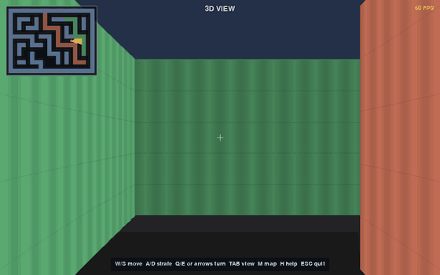

# RayCast 3D

A ray-casting engine in Python and Pygame. It turns a 2D tile map into a first-person 3D view, the same trick old games like Wolfenstein 3D used. No image assets: walls are flat colours with procedural shading.

TODO(yosef): one line on why you built it.


<!-- TODO(yosef): record GIF -->

## How to run it

Python 3.10+ with [uv](https://docs.astral.sh/uv/):

```bash
uv sync
uv run python main.py
```

Or without uv: `pip install pygame`, then `python main.py`.

| Key | Action |
| --- | --- |
| W / S or up/down | move |
| A / D | strafe |
| Q / E or left/right | turn |
| Tab | switch between 3D and top-down debug view |
| M | minimap |
| H or F1 | help |
| Esc | quit |

## How it works

Every frame casts 512 rays across a 60° field of view, one for each 2-pixel column of the 1024px window. Each ray walks the grid with DDA (`ray.py`): instead of stepping a fixed distance, it jumps straight to the next vertical or horizontal grid line, whichever is closer, until it hits a wall tile. So it never misses a wall and never wastes steps marching through open floor.

`rayCaster.py` then turns each hit distance into a wall slice. The distance is multiplied by `cos(ray angle - view angle)` first to remove the fish-eye effect, and slice height is `tile size * projection distance / distance`. Shading combines distance, which side of the wall was hit, and a sine pattern on the texture offset so the walls don't look flat.

Movement checks collisions on each axis separately, so you slide along walls instead of sticking to them. To change the maze, edit `Map.grid` in `map.py`: 0 is floor, 1–3 are wall colours.

## Tests

```bash
uv run pytest
```

8 tests cover angle wrapping, map bounds, ray hits, collisions and that the renderer actually draws.

## What's next

TODO(yosef): what's next (textures, sprites, ...?).

## License

MIT. See [LICENSE](LICENSE).
